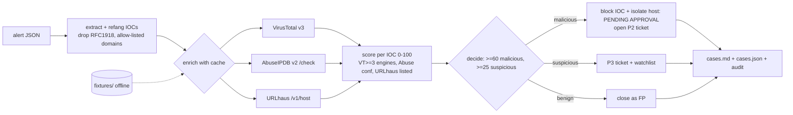

# soar-mini: IOC enrichment playbook (VirusTotal / AbuseIPDB / URLhaus, mocked offline)

> **Lab project.** The 6 alerts and all API responses are **synthetic fixtures**. Their JSON matches the public API docs, but the values are made up and the IPs are RFC 5737. Offline mode never touches the network. `--live` calls the real APIs if you set your own keys. I did **not** run live mode for these results.

## Problem
For every alert, an L1 analyst copies each IP, domain and hash into VirusTotal, AbuseIPDB and URLhaus, decides, then blocks or closes. That takes 5-10 minutes per alert and the reasoning goes unrecorded. soar-mini is a YAML-defined playbook that **extracts IOCs (refanging `hxxp`/`[.]`), enriches them with caching, scores them, decides, and proposes actions**. Destructive actions (block, isolate) stay **pending approval** unless `--approve` is given, and every step is written to an audit trail.

## Architecture


## Run
```bash
pip install -r requirements-dev.txt
pytest -q
python -m soar.playbook                    # offline fixtures, destructive actions stay pending
python -m soar.playbook --approve          # simulate approved containment
VT_API_KEY=... ABUSEIPDB_API_KEY=... URLHAUS_AUTH_KEY=... python -m soar.playbook --live --alerts my_alerts.jsonl
docker build -t soar-mini . && docker run --rm soar-mini
```

## Results (actual run, 2026-10-11, offline): `results/`
| Alert | Scenario | Verdict | Max score | Actions |
|---|---|---|---|---|
| A-1001 | EDR beacon to Qakbot C2 IP | malicious | 100 | block + isolate (pending approval), P2 ticket |
| A-1002 | user-reported phish, defanged URL | malicious | 66 | block domain + isolate (pending), P2 |
| A-1003 | single firewall probe, 1/90 VT | benign | 0 | close as FP |
| A-1004 | quarantined LockBit hash | malicious | 60 | isolate (pending), P2 |
| A-1005 | WAF 404 burst, AbuseIPDB 45% | suspicious | 27 | P3 + watchlist |
| A-1006 | lookup of never-seen domain | benign | 0 | close as FP |

Verdict accuracy is 6/6 against my labels, from 27 provider lookups. `pytest`: 6 passed.

**Tuning I did after the first run** (`results/run_v1_abuse_weight_0.4.log`): v1 scored A-1005 at 18 and **auto-closed a scanner** (5/6). I raised the AbuseIPDB weight from 0.4 to 0.6, which gives 27 and a suspicious verdict. That is tuning to my own labels, so the 6/6 figure is optimistic.

## Limitations
- The fixtures and labels are mine, so 6/6 measures the playbook logic, not real-world accuracy. Live mode is implemented but **untested here** (no API keys used).
- A-1006 is a real weakness. "No intel" is treated as benign, but a domain nobody has seen yet is often *more* suspicious. A domain-age (WHOIS/RDAP) enrichment is the fix.
- No rate limiting or backoff for the live APIs (the VT free tier allows 4 requests/min). The cache only lasts one run.
- Actions are simulated audit entries. No real firewall or EDR integration.
- The Docker image was not built yet.

## Sources
- VirusTotal API v3 (`last_analysis_stats`, `popular_threat_classification`): https://docs.virustotal.com/reference/overview
- AbuseIPDB API v2 check endpoint: https://docs.abuseipdb.com/#check-endpoint
- URLhaus API host query: https://urlhaus-api.abuse.ch/
- IOC defang conventions: https://github.com/ioc-fang/ioc-fanger (concept)
- Idea from the SOAR / Shuffle / TheHive + Cortex playbook pattern: https://shuffler.io , https://github.com/TheHive-Project/Cortex
